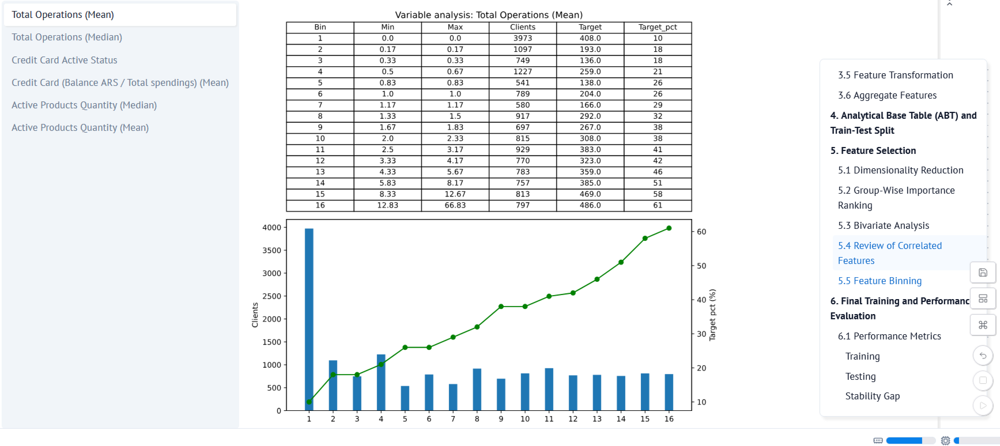

<div align="center"> <!-- rumdl-disable-line first-line-heading -->

# bank-clients-ml

Pipeline de Machine Learning reproducible para priorizar clientes con mayor propensión a
comprar un paquete financiero.

[![CI][ci-badge]][ci-link] [![Python][python-badge]](.python-version)
[![License][license-badge]](LICENSE)

[Cómo probar el proyecto con docker o en local](docs/getting-started.md) •
[Documentación completa](docs/index.md)



</div>

## Resumen

El proyecto aborda un caso de marketing dirigido:
identificar qué clientes tienen mayor probabilidad de adquirir un paquete específico y
optimizar las campañas del banco.

El repositorio contiene:

- Un notebook de Marimo que documenta el pipeline completo,
  desde el EDA hasta la evaluación final.
- Un paquete de Python con la lógica reutilizable en
  [`src/bank_clients_ml`](/src/bank_clients_ml/), separada del notebook.
- Tests unitarios y de integración con una cobertura mínima del 80 %.
- Un entorno de desarrollo reproducible con Docker, o con uv y Bun en local.
- Configuración centralizada con Pydantic Settings.
- Calidad verificada con Ruff, Pyrefly, rumdl, cspell y GitHub Actions; hooks
  opcionales.
- Decisiones de arquitectura documentadas como ADRs.

## Resultados

Según el set de test, del dataset de referencia,
contactar el 9,2 % de clientes con mayor score captura 22,1 % de los compradores.
Bajo costo por contacto constante y sin costos fijos,
el costo por comprador es 0,42 veces el baseline, o sea, un 58,2 % menos.

![Deciles en entrenamiento y prueba][deciles]

*Figura 1.
El detalle de ROC, lift, KS y deciles está en
[Resultados del pipeline](docs/architecture/pipeline.md#resultados).*

## Cómo probarlo

El proyecto se ejecuta con Docker, o con uv y Bun en local.
Los requisitos y los pasos de instalación y puesta en marcha están en
[Primeros pasos](docs/getting-started.md).

## Documentación

La documentación completa está en [`docs/index.md`](docs/index.md).

## Estructura del repositorio

```text
src/bank_clients_ml/    Paquete con la lógica del pipeline
notebooks/              Notebook de Marimo
tests/                  Pruebas unitarias y de integración
scripts/                Entrypoint de Docker y validaciones
data/                   Conjunto de datos de ejemplo
docs/                   Documentación del proyecto
docs/assets/            Diagramas, gráficos y capturas
```

## Stack tecnológico

| Área | Herramientas |
| --- | --- |
| Datos y modelo | Polars, NumPy, SciPy, scikit-learn, LightGBM, Matplotlib |
| Notebook | Marimo |
| Diagramas | Mermaid, SVG |
| Configuración | Pydantic Settings |
| Calidad | pytest, Ruff, Pyrefly, rumdl, cspell, SVGO |
| CI | GitHub Actions |
| Entorno | Python 3.13, uv, Bun, Docker Compose, Lefthook, Commitizen |

## Contribución

Este repositorio se mantiene como un proyecto personal,
por lo que no se aceptan contribuciones externas.
Ver [CONTRIBUTING.md](CONTRIBUTING.md).

## Licencia

Este proyecto está bajo los términos de la **Licencia MIT**.
Consultar el archivo [LICENSE](LICENSE) para más detalles.
Las dependencias externas utilizadas mantienen sus respectivas licencias,
tales como Apache 2.0.

[deciles]: docs/assets/plots/plot_evaluation_metrics/deciles.svg

[ci-badge]: https://github.com/deheza-alejandro/bank-clients-ml/actions/workflows/ci.yml/badge.svg
[ci-link]: https://github.com/deheza-alejandro/bank-clients-ml/actions/workflows/ci.yml
[python-badge]: https://img.shields.io/badge/dynamic/regex?url=https://raw.githubusercontent.com/deheza-alejandro/bank-clients-ml/main/.python-version&search=(.*)&replace=$1&label=Python&color=3776AB&logo=python&logoColor=white
[license-badge]: https://img.shields.io/github/license/deheza-alejandro/bank-clients-ml
