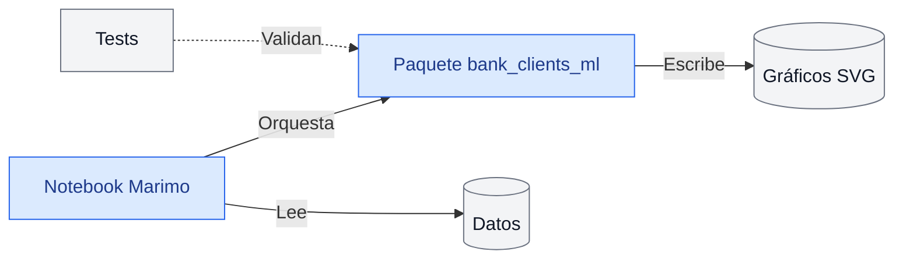

# Arquitectura

El notebook orquesta y documenta el análisis; el paquete `bank_clients_ml`
implementa la lógica reutilizable del pipeline. Las decisiones de diseño se
registran en [Decisiones de arquitectura](decisions.md).

## Mapa de componentes

*Figura. La lógica se concentra en el paquete; el recorrido visual está en [Pipeline](pipeline.md).*

## Módulos

| Módulo | Responsabilidad |
| --- | --- |
| `cleaning.py` | Limpieza inicial de los datos crudos. |
| `sampling.py` | Ventanas temporales de entrenamiento y predicción; muestreo estratificado. |
| `feature_engineering.py` | Imputación, codificación, variables derivadas de fechas y agregación. |
| `column_groups.py` | Agrupación de columnas por fuente de negocio. |
| `redundant_column_filter.py` | Filtrado de columnas constantes, desbalanceadas o correlacionadas. |
| `binning.py` | Agrupación de variables en bines y codificación por porcentaje de target. |
| `training.py` | Entrenamiento de LightGBM, ranking por grupos y búsqueda de hiperparámetros. |
| `evaluation.py` | Métricas de clasificación binaria, lift y estadística KS por deciles. |
| `eda.py` | Funciones auxiliares de inspección y descripción de DataFrames. |
| `visualization.py` | Generación de gráficos para análisis, selección de features y evaluación. |
| `bivariate_analysis.py` | Análisis bivariado y selección visual de variables. |
| `bivariate_table.py` | Construcción de tablas para el análisis bivariado. |
| `marimo_utils.py` | Helpers para mostrar resultados en cuadernos Marimo. |

La generación de gráficos y diagramas se rige por
[Convenciones visuales](../development/visuals.md).

## Estrategia de pruebas

Las pruebas unitarias cubren los módulos del paquete; las de integración
validan la carga de datos, la preparación y el pipeline completo. Los marcadores
`slow`, `requires_svg` y `requires_real_env` identifican requisitos específicos
y se definen en `pyproject.toml`. La política de cobertura y los comandos de
validación están en [Comandos de desarrollo](../development/commands.md).

## Limitaciones y próximos pasos

El repositorio cubre el proceso analítico y de experimentación. No incluye un
servicio de inferencia, CI, monitoreo de drift ni registro de modelos.

Los próximos pasos posibles son:

- Batch scoring programado.
- Empaquetado y despliegue del modelo.
- CI para ejecutar las validaciones en cada cambio.
- Monitoreo de drift y alertas sobre la distribución de entradas y resultados.
- Registro de modelos y versionado de artefactos.
