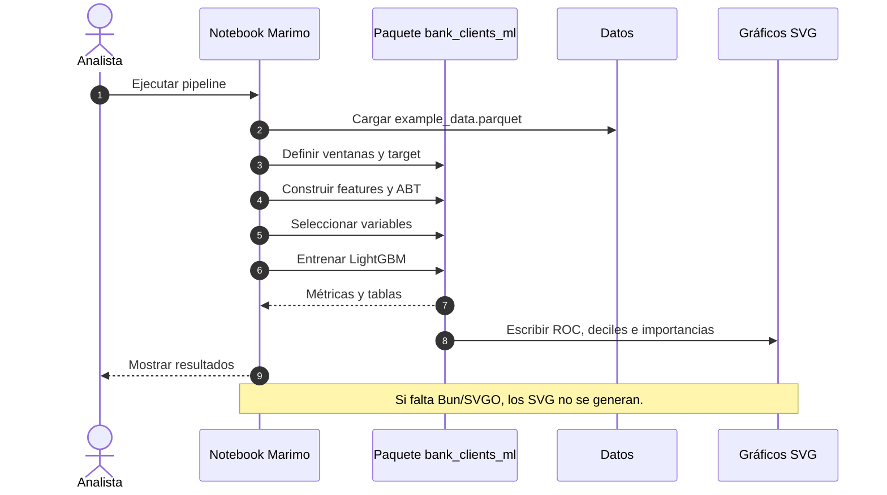

# Pipeline

Recorrido del pipeline de bank-clients-ml: qué entra,
qué se transforma y cómo se evalúa.

## Etapas del pipeline

| Etapa | Resultado |
| --- | --- |
| 1. EDA y limpieza inicial | Dataset consistente y tipado |
| 2. Universo, target y ventanas temporales | Primera compra definida sin fugas temporales de información |
| 3. Feature engineering | Variables derivadas de saldos, operaciones, tarjetas y recencia |
| 4. ABT y partición entrenamiento/prueba | Tabla analítica base y split estratificado |
| 5. Selección de features | Eliminación de redundancias y ranking por grupos |
| 6. Entrenamiento y evaluación | Evaluación por deciles, lift y KS |

## Interacción entre notebook y paquete

La secuencia muestra el orden temporal de una ejecución, no las funciones internas.

*Figura 1.
La secuencia cubre el flujo esperado.
La separación de responsabilidades está en [Arquitectura](overview.md).*

### Volumen de datos por etapa

La siguiente tabla muestra cómo cambian las dimensiones de los datos en cada etapa del
pipeline.

| Etapa | Granularidad | Filas | Columnas |
| --- | --- | ---: | ---: |
| Datos crudos | cliente-mes | 238.616 | 77 |
| Universo modelable | cliente-mes | 139.146 | 77 |
| Feature Transformation | cliente-mes | 139.146 | 167 |
| ABT final | cliente | 23.191 | 1593 |
| Feature Selection | cliente | 23.191 | 4 |

*El pipeline pasa de registros mensuales a una fila por cliente antes del modelado.*

## Selección de features

El modelo final usa solo cuatro features.

![Ranking de importancia de las features finales][importancias]

*Figura 2.
Las cuatro features finales concentran la información usada por el modelo.
El [ranking por grupos][top_grouped] está disponible como SVG.*

## Resultados

Los resultados corresponden a una ejecución completa sobre `data/example_data.parquet`.
Los valores pueden variar si cambia el conjunto de datos.

### Curva ROC

![Curva ROC del modelo final][roc]

*Figura 3.
La curva ROC resume la capacidad de discriminación del modelo sobre el conjunto de
prueba.
El cálculo está en [`evaluation.py`](/src/bank_clients_ml/evaluation.py).*

### Deciles

Ordenamiento correcto en todos los deciles,
con una distribución relativamente homogénea.

![deciles][deciles]

*Figura 4.
El decil superior mantiene el mayor lift en entrenamiento y prueba.*

La diferencia de lift entre entrenamiento y prueba es mínima.

| Métrica | Entrenamiento | Prueba |
| --- | --- | --- |
| Lift del decil superior | 2,4 | 2,39 |
| KS | 47,03 | 48,19 |

El análisis bivariado completo está en
[`docs/assets/plots/bivariate_analysis/`](/docs/assets/plots/bivariate_analysis/).

## Reproducir

Los pasos están en [Primeros pasos](../getting-started.md) y el código en
[`notebooks/notebook.py`](/notebooks/notebook.py).

[importancias]: ../assets/plots/plot_top_features/best_features.svg
[roc]: ../assets/plots/plot_evaluation_metrics/roc_curve.svg
[deciles]: ../assets/plots/plot_evaluation_metrics/deciles.svg
[top_grouped]: ../assets/plots/plot_top_features/top_grouped_features.svg
