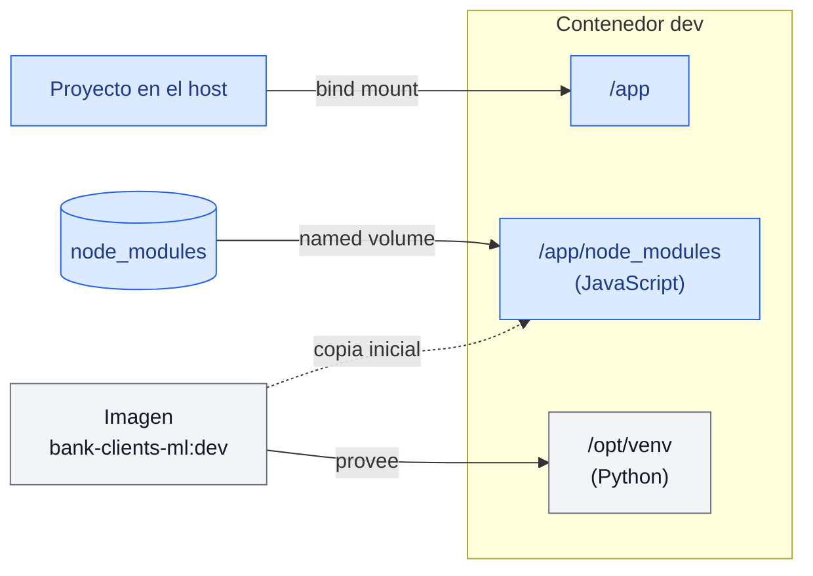
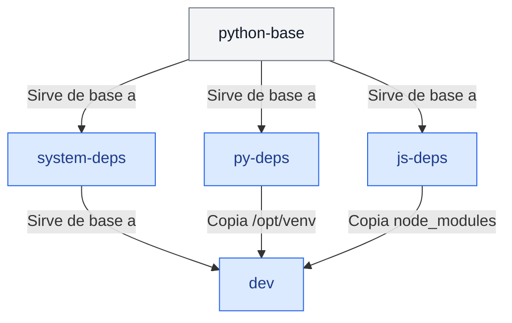

# Docker

## Entorno y volúmenes

El bind mount y el volumen `node_modules` persisten al recrear el contenedor.



*Figura 1.
Origen de las rutas principales del contenedor.*

`node_modules` debe estar dentro de `/app` pero un bind mount expondría los binarios del
host, por lo tanto se monta desde un named volume.
En cambio, `/opt/venv` no es un volumen:
Python no requiere que las dependencias estén dentro de `/app`,
por lo que permanece en la imagen y sus cambios se descartan al eliminar el contenedor.
La sincronización de dependencias se detalla en [Entrypoint](#entrypoint).

`data/` y `docs/assets/` forman parte del bind mount;
las operaciones de volúmenes no afectan su contenido.

## Actualizar el entorno

Los archivos montados con bind mount se actualizan sin reconstruir la imagen.

| Cambio | Acción | ¿Reconstruir? |
| --- | --- | --- |
| `src/`, `tests/`, `notebooks/`, `README.md`, `docs/`, `data/` y configuración de herramientas (excepto `pyproject.toml`) | Nada: están montados con bind mount | No |
| `pyproject.toml`, `uv.lock` | `docker compose restart dev` (o `docker compose up -d` si está detenido) | No obligatorio, pero recomendado |
| `package.json`, `bun.lock` | `docker compose restart dev` (o `docker compose up -d` si está detenido) | No obligatorio, pero recomendado |
| `Dockerfile`, `.dockerignore`, `scripts/docker_entrypoint.py` | `docker compose up --build` | Sí |
| `.python-version`, `PYTHON_VERSION` o imágenes base | Validar versiones (ver [Comandos de desarrollo](commands.md)) y `docker compose build --pull && docker compose up` | Sí |

Para los cambios de locks, reconstruir es opcional para el contenedor actual,
pero recomendado para mantener la imagen reproducible y actualizar la copia base de
`/opt/venv` y `node_modules` para contenedores nuevos.
El primer arranque después de un cambio necesita red si hay paquetes nuevos que
descargar.

Para restablecer el volumen de `node_modules`,
ver [Dependencias y locks](../troubleshooting.md#dependencias-y-locks).
Para actualizar la copia base de `/opt/venv`, reconstruir la imagen.

## Entrypoint

El entrypoint definido en el `Dockerfile` sincroniza las dependencias de Python y
JavaScript antes de iniciar el contenedor.
Para Python ejecuta `uv sync --locked` contra `/opt/venv`;
para JavaScript ejecuta `bun install --frozen-lockfile` en el volumen `node_modules`
cuando el hash de `package.json`, `bun.lock` y la versión de Bun difiere de
`node_modules/.bun-install-hash`.
Si el entorno ya está al día, no reinstala nada.

La imagen escribe el marker con el mismo código que se ejecuta en runtime.
Un volumen nuevo copia ese archivo de la imagen,
así que el primer arranque no necesita ejecutar `bun install`.
En un volumen creado con una versión anterior del entrypoint el marker no existe y se
ejecuta una instalación completa.

Como el entrypoint usa `--locked` y `--frozen-lockfile`,
la sincronización falla si los locks no están al día;
ver [Dependencias y locks](../troubleshooting.md#dependencias-y-locks).

El entrypoint no descarga intérpretes (`UV_PYTHON_DOWNLOADS=never`);
solo sincroniza paquetes con el intérprete de la imagen.
Se copia fuera de `/app` para que el bind mount no lo oculte.

## Comandos para actualizar locks

| Lock | En local | En el contenedor |
| --- | --- | --- |
| `uv.lock` | `uv lock` | `docker compose run --rm --entrypoint uv dev lock` |
| `bun.lock` | `bun install` | `docker compose run --rm --entrypoint bun dev install` |

Los cambios se escriben en el host a través del bind mount; revisar el diff y reiniciar:

```bash
docker compose restart dev
```

Los comandos con `--entrypoint` reemplazan el [entrypoint](#entrypoint) y se saltan la
sincronización de dependencias y la instalación del proyecto.
Usar estos comandos solo para herramientas que no necesitan `bank_clients_ml`,
como `uv lock` o `bun install`.
Para tests o scripts que importan el paquete,
ver [Comandos de desarrollo con Docker](commands.md#comandos-de-desarrollo).

## Detalles de la imagen

La imagen se organiza en etapas que parten de una base común:



*Figura 2.
La separación permite construir dependencias en paralelo y reutilizar los artefactos en
la imagen final.*

`python-base` contiene solo Python y uv.
Mantener fuera `apt`, el usuario de desarrollo y Bun permite que las etapas de
dependencias empiecen antes y sobrevivan a cambios en esos elementos.
`system-deps` agrega las librerías del sistema sobre `python-base`;
`py-deps` y `js-deps` construyen las dependencias en paralelo.
`dev` es la imagen final.

`system-deps` instala `libgomp1`, requerido por LightGBM, y `fonts-dejavu-core`,
que mantiene reproducible la salida de Matplotlib.
Los cache mounts de BuildKit para el índice y los paquetes de `apt` evitan que esos
archivos formen parte de la imagen.

`py-deps` instala solo dependencias de terceros.
El proyecto no se instala en esta etapa porque el entrypoint ejecuta `uv sync --locked`
en cada arranque e instala el paquete desde el código montado en aproximadamente un
segundo.
Como los cambios en `src/` no modifican las dependencias, la capa se reutiliza.
El trade-off es que los errores de empaquetado aparecen al iniciar el contenedor y no
durante el build; por eso CI construye la imagen y ejecuta un smoke test del entrypoint,
que instala el proyecto y arranca el servicio.
Ver [CI](ci.md#docker).
El primer `uv sync` monta `.python-version` para fallar rápido si la versión no coincide
con la imagen.

`js-deps` instala las herramientas JavaScript que usan SVGO y cspell.
Esta etapa toma Python solo para el helper del marker;
no espera a `apt` ni al usuario de desarrollo.
La imagen de Bun distribuye `bunx` como symlink,
así que al copiar solo el binario `bun` se recrea el enlace.

`dev` crea un usuario de desarrollo sin privilegios y copia Bun en runtime.
Bun se copia tanto en `js-deps` como en `dev` porque las etapas de Docker no comparten
archivos: `js-deps` lo necesita para `bun install` y `dev` para el entrypoint y la suite
de tests.
Las dependencias se copian antes que la aplicación;
la copia de la aplicación permite usar la imagen sin bind mount.
La imagen final incluye Python, uv, Bun,
todas las dependencias listadas en el `pyproject.toml` y todas las dependencias listadas
en el `package.json`.

No hay un entorno de producción todavía.

## Dockerignore

El `.dockerignore` no ignora dos archivos por motivos específicos:

- `README.md`, porque `uv_build` lo lee cuando el entrypoint instala el proyecto
y cuando la imagen se usa sin bind mount;
- y `.gitignore`, porque cspell lo usa mediante `useGitignore`.
